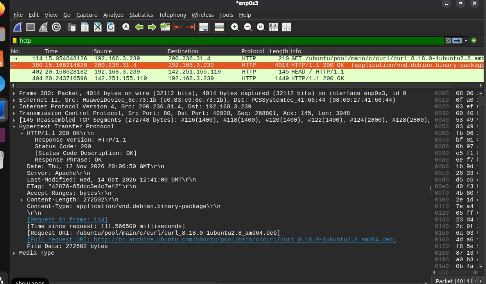

Na captura realizada e filtrada pelo protocolo `http`, foi analisada uma requisição destinada ao endereço `http://www.google.com/`. No pacote de requisição enviado pelo cliente, identificou-se o método `HEAD`/`GET` para a URL raiz `/`, enquanto o pacote de resposta retornou o código de status `200 OK`. Nos cabeçalhos HTTP da resposta, verificou-se o campo `Content-Type: text/html; charset=ISO-8859-1` e o cabeçalho `Server: gws` (Google Web Server).

EOF