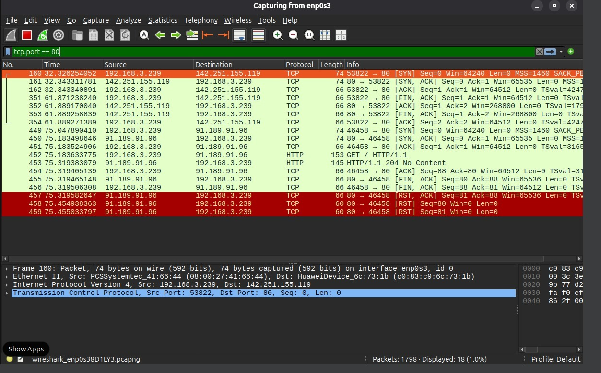

A captura realizada durante o acesso via `telnet` na porta 80 demonstra as etapas de controle de uma sessão TCP. O estabelecimento da conexão ocorre nos três primeiros pacotes (three-way handshake): o cliente envia um segmento `[SYN]`, o servidor responde com `[SYN, ACK]` e o cliente confirma com `[ACK]`. Ao encerrar a sessão no telnet, observa-se o fechamento da conexão por meio do envio dos segmentos `[FIN, ACK]` e suas respectivas confirmações `[ACK]`.

EOF