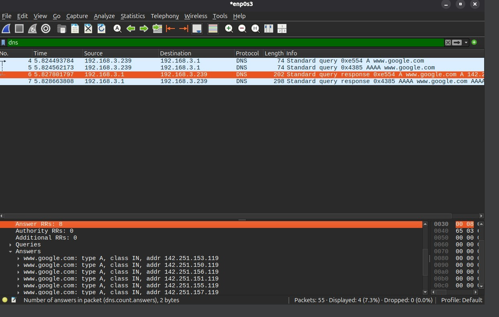

Ao filtrar os pacotes pelo protocolo `dns` após requisitar o domínio `www.google.com`, observaram-se consultas do tipo `A` (IPv4) e `AAAA` (IPv6) enviadas ao servidor DNS configurado na rede local. Nos pacotes de resposta (`Standard query response`), o servidor DNS retornou os registros contendo os endereços IP correspondentes ao domínio consultado, permitindo o posterior estabelecimento da comunicação com o servidor web.

EOF