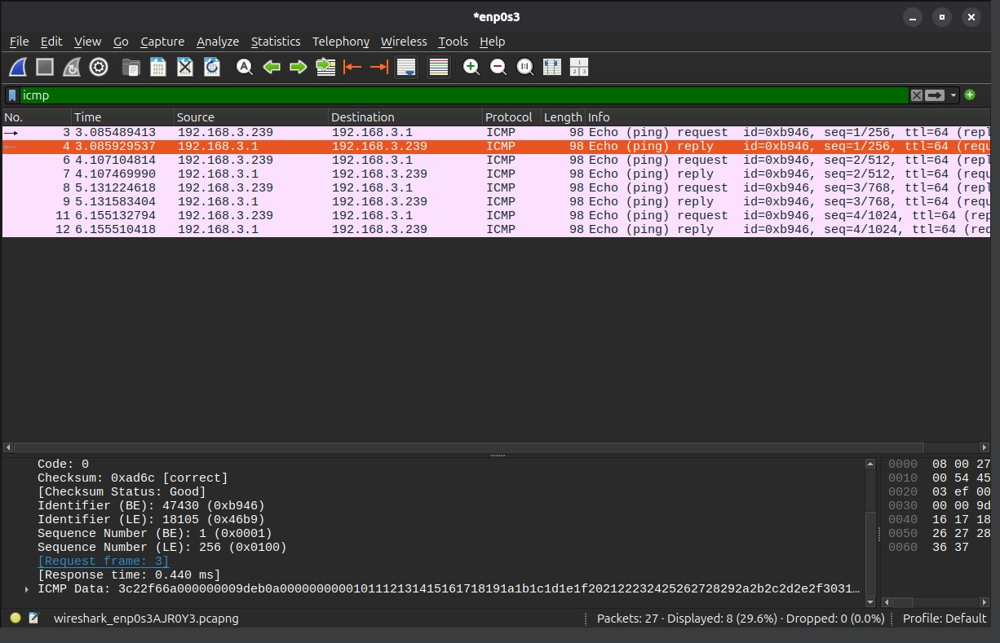

A captura filtrada pelo protocolo `icmp` registra o teste de conectividade com o comando `ping` na rede local (`192.168.3.1`), exibindo os pares de pacotes `Echo (ping) request` e `Echo (ping) reply`. Na inspeção dos pacotes de resposta no Wireshark, foi possível identificar o tempo de ida e volta (RTT - Response time) em milissegundos para cada pacote enviado, confirmando a comunicação sem perda de pacotes.

EOF