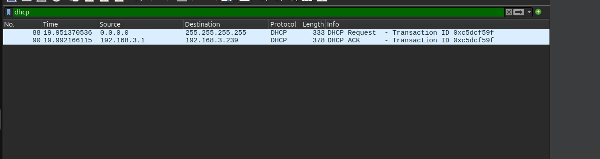

Durante a renovação de endereço IP na interface `enp0s3` utilizando o utilitário `dhclient`, a captura filtrada por `dhcp` registrou as quatro mensagens do processo DORA. Inicialmente o cliente enviou um `DHCP Discover` em broadcast para localizar servidores ativos, recebeu um `DHCP Offer` com uma proposta de configuração, enviou o `DHCP Request` solicitando o endereço ofertado e, por fim, recebeu o `DHCP ACK` confirmando a alocação do endereço IP na rede.

EOF